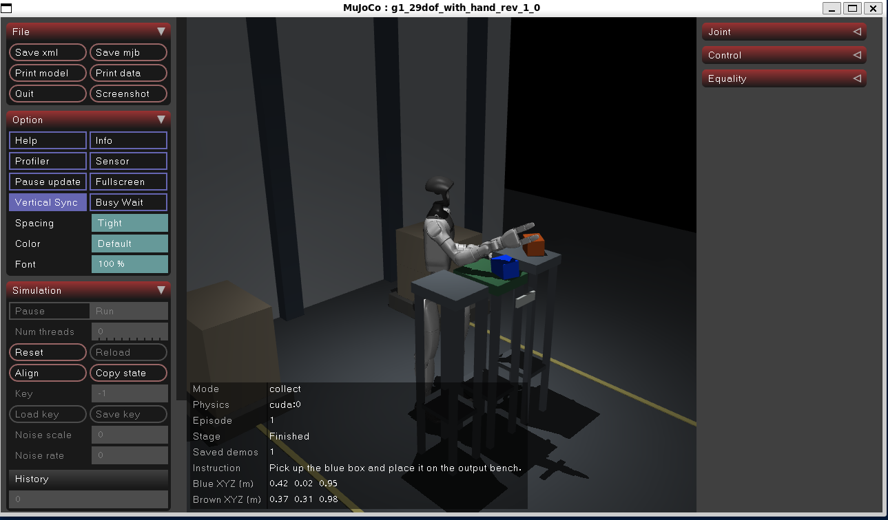

# Unitree G1 simulation and vision-language-action experiments



*MuJoCo workstation in `collect` mode after a successful box transfer. The overlay shows CUDA physics, the task instruction, and the recorded demonstration count.*

| Workflow | Controller | Task and viewer |
| --- | --- | --- |
| MuJoCo workstation, `collect` | Scripted demonstration teacher | Fixed-base G1 transfers boxes, native MuJoCo GUI and live telemetry |
| MuJoCo workstation, `run` | Fine-tuned SmolVLA | Fixed-base box transfer, native MuJoCo GUI |
| MuJoCo SONIC rollout | Pretrained pi0.5 plus SONIC | Whole-body walking, live Rerun viewer in the Windows browser |
| Isaac Lab Arena | Pretrained GR00T N1.6 plus whole-body control | Walk, pick up a box with both hands, carry it and place it, Isaac Sim GUI |

## Quick start on Ubuntu-MuJoCo

From an existing checkout with the Python environment and Menagerie assets installed:

```bash
cd ~/VLA_UNITREE && git pull --ff-only origin main && source .venv-vla/bin/activate &&
env -u LIBGL_ALWAYS_SOFTWARE MUJOCO_GL=egl GALLIUM_DRIVER=d3d12 MESA_D3D12_DEFAULT_ADAPTER_NAME=NVIDIA \
  python -u demo.py collect --assets ~/mujoco-demo/mujoco_menagerie/unitree_g1 \
  --device cuda:0 --episodes 1 --dataset "runs/g1-preview-$(date +%s)"
```

This is the local smoke test for the GUI and CUDA physics. The scripted teacher drives this run. For VLA inference, use one of the trained checkpoint workflows below.

## Pretrained whole-body VLA in MuJoCo

The published [nepyope/sonic_walk](https://huggingface.co/nepyope/sonic_walk) pi0.5 checkpoint controls walking. It uses the head camera and the SONIC whole-body decoder. The published weights are about 16.6 GB in float32, which exceeds the RTX 3060 Laptop GPU's 6 GB of VRAM. No compatible smaller walking checkpoint is included or validated.

Set up the [LeRobot G1 environment](https://huggingface.co/docs/lerobot/en/unitree_g1#part-1-getting-started) with Python 3.12, Unitree SDK2 Python, Cyclone DDS and the simulator dependencies. The [Unitree SDK instructions](https://github.com/unitreerobotics/unitree_sdk2_python) cover building Cyclone DDS 0.10.x if no compatible wheel is available.

```bash
source .venv-vla/bin/activate
uv pip install "lerobot[unitree-g1,pi,core-scripts]==0.7.0" mujoco loguru msgpack msgpack-numpy
python -c 'import torch, unitree_sdk2py; from lerobot.robots.unitree_g1.controllers.sonic_whole_body import SonicWholeBodyController; assert torch.cuda.is_available(); print(torch.cuda.get_device_name(0))'
```

On a workstation with sufficient VRAM and disk space, download the checkpoint explicitly, then launch with its local path:

```bash
hf download nepyope/sonic_walk --local-dir runs/sonic-walk
python -u run_sonic_vla.py --device cuda --checkpoint runs/sonic-walk
```

Open the printed Rerun URL in Edge or Chrome. The launcher requires a local policy directory before it starts a viewer or rollout. Other runtime assets may still download. The native viewer is available with `--viewer native`; the browser viewer avoids the native WSL `R32Float` graphics error.

## WSL storage recovery

If both Git and the model cache report `Read-only file system` or `Input/output error`, stop the rollout and use PowerShell to check Windows disk space. Back up the distribution's VHDX before filesystem repair. Follow the [Microsoft WSL disk recovery guide](https://learn.microsoft.com/en-us/windows/wsl/disk-space) and verify the target device before running `e2fsck`. After rebooting WSL, verify writes and run the local GUI smoke test above. A rollout message saying it returned a model without pretrained weights indicates a failed checkpoint load, even if a later line says the policy loaded.

## Whole-body humanoid VLA with NVIDIA GR00T

For a walking humanoid demo, use the official Isaac Lab Arena **G1 Loco-Manipulation Box Pick and Place** scenario. The G1 walks to the shelf, picks up the box with both hands, and deposits it in the output bin. This uses the published GR00T N1.6 checkpoint and the Arena whole-body controller in the Galileo Lab scene. The checkpoint is adapted to that scene and embodiment.

1. Install [Isaac Lab Arena](https://isaac-sim.github.io/IsaacLab-Arena/release/0.3.1/) on a compatible GPU workstation. Check the [Isaac Sim system requirements](https://docs.isaacsim.omniverse.nvidia.com/5.1.0/installation/requirements.html) before installing.
2. Follow the [official evaluation setup](https://isaac-sim.github.io/IsaacLab-Arena/release/0.3.1/pages/example_workflows/locomanipulation/step_5_evaluation.html) to download the pretrained checkpoint and start the GR00T policy server. The checkpoint is [GN1x-Tuned-Arena-G1-Loco-Manipulation](https://huggingface.co/nvidia/GN1x-Tuned-Arena-G1-Loco-Manipulation), revision `gn1_6`.
3. Use the Arena evaluation environment to launch the demo with cameras and the Kit GUI. Point the command at your actual checkouts:

```bash
python /path/to/VLA_UNITREE/run_humanoid_vla.py --arena /path/to/IsaacLab-Arena
```

The launcher uses the same pretrained policy configuration as the NVIDIA tutorial. It requires the separately installed Arena runtime and a running GR00T server. The MuJoCo workstation below remains available for local collection and telemetry.

## Watch live telemetry

The viewer shows the operating mode, physics device, episode, stage, instruction, saved demonstrations, and box positions. A timestamped CSV under `runs/telemetry-*.csv` is written throughout each session. The reported XYZ positions are simulator telemetry and are not passed into SmolVLA during inference. The demonstration dataset is saved separately under the path set with `--dataset`.

## Who controls the robot?

In `run` mode, a trained **SmolVLA checkpoint** receives the RGB camera image, robot joint state, and complete text instruction. Its action commands set 15 G1 joint targets and the two simulated gripper commands. The simulator applies limits, checks whether the commanded gripper is near a box, and simulates the release. The model chooses which box to approach, which hand to use, and when to close and open the gripper.

`collect` mode uses a scripted teacher solely to record demonstrations for training. The teacher does not run during policy inference. The G1 uses the Menagerie model with articulated fingers. Each grip command flexes the thumb, index, and middle fingers progressively. The robot has a fixed base and an assisted grasp. Finger motion is visual and does not model the contact forces needed to hold the box. A trained G1 checkpoint is required and is not included.

## Install in Ubuntu-MuJoCo

```bash
cd ~/VLA_UNITREE
git pull --ff-only origin main
uv venv --python 3.12 .venv-vla
source .venv-vla/bin/activate
uv pip install -r requirements.txt "lerobot[smolvla,training]==0.7.0"
unset LIBGL_ALWAYS_SOFTWARE
export GALLIUM_DRIVER=d3d12
export MESA_D3D12_DEFAULT_ADAPTER_NAME=NVIDIA
```

Use a separate Python 3.12 environment. LeRobot 0.7.0 resolves to NumPy 2.2.6, which supports Python through 3.13. The original MuJoCo environment can remain on Python 3.14. For a new setup, clone this repository and run the same installation commands. Get the robot assets from the [MuJoCo Menagerie](https://github.com/google-deepmind/mujoco_menagerie/tree/main/unitree_g1). The examples below assume the assets, including `g1_with_hands.xml`, are already present in your original MuJoCo directory.

## 1. Collect visible training demonstrations

```bash
python demo.py collect \
  --assets ~/mujoco-demo/mujoco_menagerie/unitree_g1 \
  --device cuda:0 --episodes 60 --dataset runs/g1-boxes
```

Collection alternates blue and brown instructions. Demonstrations approach the box slowly, close the fingers at pickup, lift before carrying, and lower the box onto the output bench before reopening the fingers. Use a new dataset path when recollecting after a motion update. The visible teacher saves successful episodes as a local LeRobot dataset. Each frame records camera RGB, robot state, the complete task instruction, and joint and gripper actions. Close the viewer to stop collection early and save completed episodes.

## 2. Fine-tune SmolVLA on the G1 action space

```bash
lerobot-train \
  --policy.path=lerobot/smolvla_base \
  --policy.input_features='{"observation.images.camera1":{"type":"VISUAL","shape":[3,240,320]},"observation.state":{"type":"STATE","shape":[17]}}' \
  --policy.push_to_hub=false --policy.device=cuda \
  --dataset.repo_id=local/g1-boxes --dataset.root=runs/g1-boxes \
  --batch_size=1 --steps=10000 --output_dir=runs/g1-smolvla
```

This is a starting configuration. Training and inference memory requirements need to be checked on the target GPU. If training exceeds available VRAM, train on a larger GPU and copy the resulting checkpoint to the PC. See the [SmolVLA fine-tuning guide](https://huggingface.co/docs/lerobot/main/smolvla).

## 3. Watch SmolVLA control the robot

```bash
MUJOCO_GL=egl python demo.py run \
  --assets ~/mujoco-demo/mujoco_menagerie/unitree_g1 \
  --checkpoint runs/g1-smolvla/checkpoints/last/pretrained_model \
  --device cuda:0 --policy-device cuda --seed 73 \
  --instruction "Pick up the blue box and place it on the output bench."
```

Change `blue` to `brown` to test the other condition. Use seeds distinct from collection for evaluation. The terminal reports which box reached the output after the episode. The simulation remains visible until you close the window.
